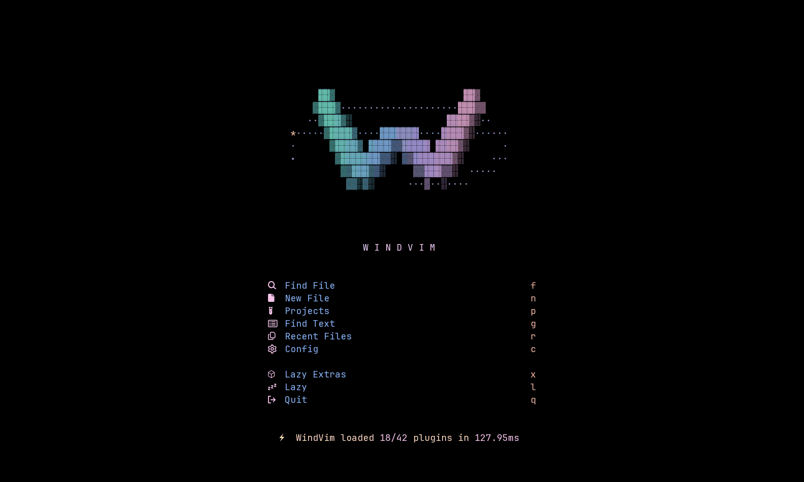
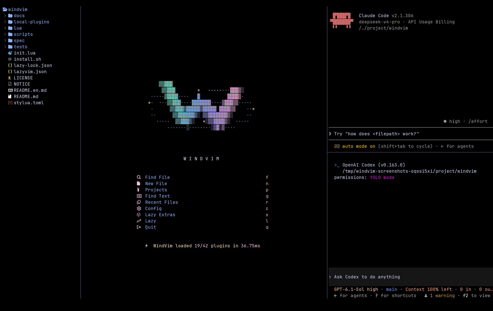
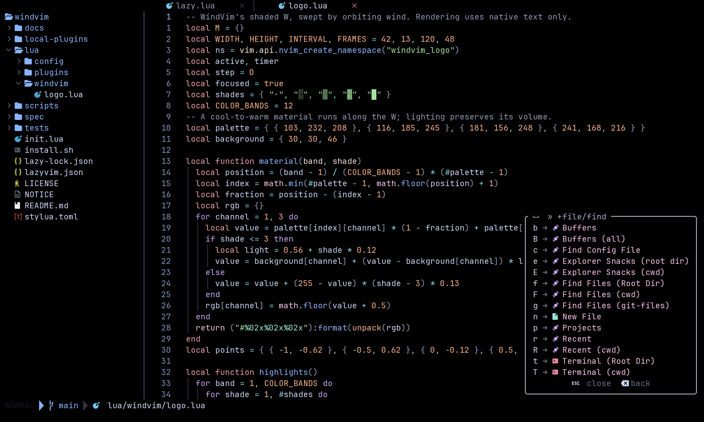
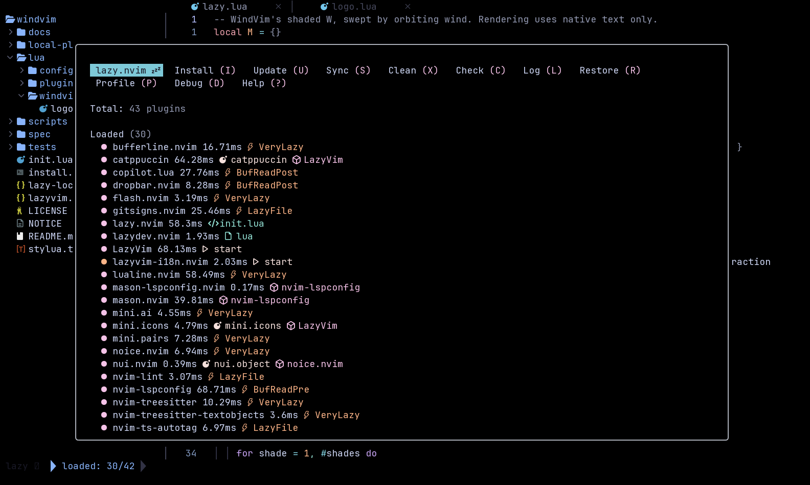

<p align="center">
  
</p>

<h1 align="center">WindVim</h1>

<p align="center">
  <a href="README.md">简体中文</a> · <strong>English</strong>
</p>

<p align="center">
  <strong>A LazyVim-based Neovim configuration with bilingual UI, AI sidebars and floating terminals</strong>
</p>

<p align="center">
  <a href="https://www.lazyvim.org/"></a>
  <a href="https://neovim.io/"></a>
  
  <a href="LICENSE"></a>
</p>

WindVim is a personal Neovim configuration built on [LazyVim](https://github.com/LazyVim/LazyVim), for terminal development with a bilingual interface and AI coding tools. It combines LazyVim's plugin ecosystem, language support and keymaps with a ready-to-use workspace and visual customization.

It runs as the separate `windvim` application alongside your existing Neovim or LazyVim setup. Supports Linux and macOS, plus Windows through WSL.

## Features

- **Chinese / English UI**: switch the dashboard, key hints, plugin manager and common pickers at any time. Your choice is saved; file contents, paths and commands stay intact.
- **AI CLI sidebars**: use installed tools such as Codex and Claude through Sidekick, with multiple panels stacked in one column.
- **Terminals and navigation**: a centered floating terminal, file explorer, project search, Bufferline and Dropbar, with familiar LazyVim controls.
- **Custom visuals**: a transparent Catppuccin theme, Markdown rendering and an animated dashboard with a colorful W, shaded wind rings and moving particles.
- **Independent configuration**: the installer protects existing directories and backs them up before an explicit overwrite. Themes, keymaps and the local translation layer are easy to customize.



Stack Claude Code and Codex on the right while keeping the file tree and main workspace visible:



Open a project to browse key hints beside your code or manage extensions in the plugin manager:





See the [gallery](docs/GALLERY.en.md) for more views.

## Install

> **Requirements**: Neovim ≥ 0.11.2 with LuaJIT, Git and `rsync`. See the [usage guide (Chinese)](docs/USAGE.md) for full dependencies and platform notes.

```bash
git clone https://github.com/tingfeng347/windvim.git
cd windvim
./install.sh
# Open a new terminal after installation
LAZYVIM_LANGUAGE=en windvim
```

The installer uses the independent `~/.config/windvim` directory without sudo and automatically adds the launcher directory to your Bash, Zsh or Fish PATH configuration. Open a new terminal and run `windvim`. On first launch, plugins are downloaded from GitHub. Use `./install.sh` if you already have the source locally.

`LAZYVIM_LANGUAGE=en` selects English for that launch. To save English as your preference, run `:LazyVimLanguage en` inside WindVim; later launches can use `windvim` without the environment variable.

Installation options, source archive downloads and platform dependencies are covered in the [usage guide (Chinese)](docs/USAGE.md). Copilot and AI CLIs require their own sign-in; regular editing works independently.

## Launch And Use

After installation, open a new terminal and run `windvim` from any directory; you do not need to return to the source checkout:

```bash
# Open the dashboard
windvim

# Start in a project, then press Space followed by e to open the file tree
cd /path/to/your/project
windvim

# Edit a file directly
windvim README.md
```

The installer cannot change an already open terminal's environment. Use `~/.local/bin/windvim` in that terminal, or open a new terminal and run `windvim`. Existing shell configuration files are backed up before changes, and repeated installations do not add duplicate configuration. Use `--no-path` to skip automatic PATH setup.

For a `--no-launcher` installation, run `NVIM_APPNAME=windvim nvim`. If you also used `--appname my-windvim`, run `NVIM_APPNAME=my-windvim nvim`. The default `windvim` launcher selects the application name used during installation automatically. Keep the same XDG environment variables when launching a custom XDG installation, and use the launcher in your chosen directory if you set `WINDVIM_BIN_DIR`.

Wait for plugin installation on the first launch. On the dashboard, press `f` to find a file, `n` to create one, or `q` to quit. While editing, press `Esc`, type `:wq` and press Enter to save and close the current window.

## Update

Run in your original clone:

```bash
git pull --ff-only
./install.sh --force
```

The previous configuration is backed up before replacement. Manage plugins inside the editor with `:Lazy`.

## Uninstall

Close WindVim, then run from the source checkout:

```bash
./uninstall.sh
# Also remove plugin data, cache and state
./uninstall.sh --purge
```

The script moves the configuration and matching launcher to timestamped backups. Plugin data, cache and state are kept unless `--purge` is specified; configuration backups remain. Use `--appname NAME` for a custom installation, or `--no-launcher` to keep the launcher. XDG paths and `WINDVIM_BIN_DIR` are supported.

## Keymaps

The leader key is Space. Other controls follow the [LazyVim default keymaps](https://www.lazyvim.org/keymaps).

| Action | Keymap |
| --- | --- |
| Switch Chinese / English | `<Space>uH` |
| Find files / search text | `<Space>ff` / `<Space>sg` |
| File explorer | `<Space>e` |
| Centered floating terminal | `<Space>tp` |
| Toggle / select AI CLI | `<Space>aa` / `<Space>as` |

## Documentation

- [Gallery](docs/GALLERY.en.md): English key hints, file picker and plugin manager
- [Usage guide (Chinese)](docs/USAGE.md): dependencies, installer options, AI setup, customization, updates and removal
- [Translation plugin (Chinese)](local-plugins/lazyvim-i18n.nvim/README.md): coverage, language switching and custom translations
- [Development and distribution (Chinese)](docs/DEVELOPMENT.md): tests, screenshot recording and source packaging

## License

[Apache-2.0](LICENSE). Based on [LazyVim](https://github.com/LazyVim/LazyVim) and [LazyVim Starter](https://github.com/LazyVim/starter). Thanks to [folke](https://github.com/folke) and all plugin authors; see [NOTICE](NOTICE) for attribution and modifications.
