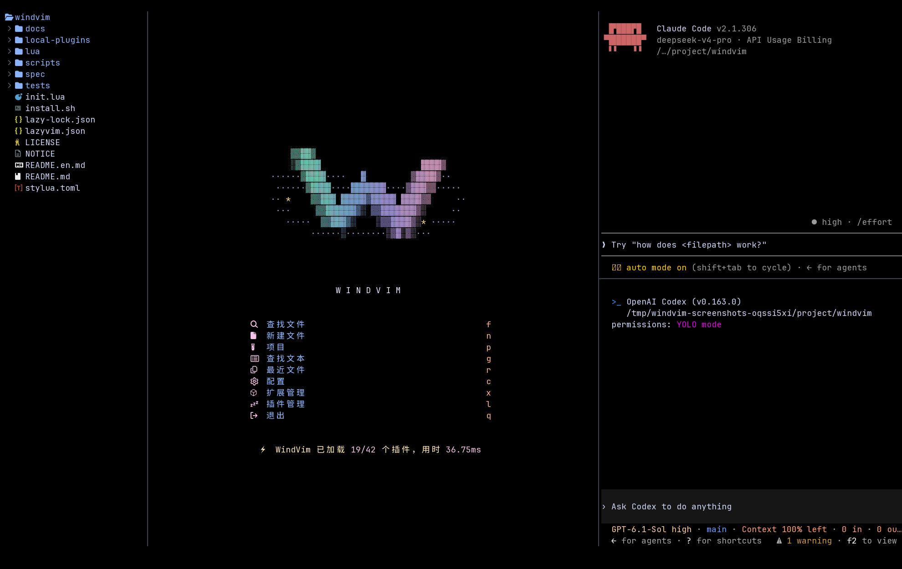
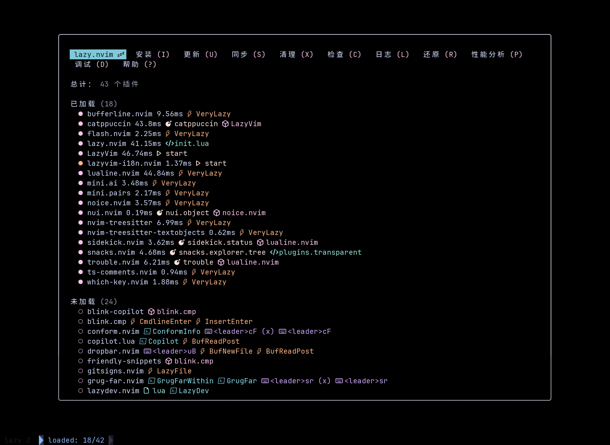

<p align="center">
  
</p>

<h1 align="center">WindVim</h1>

<p align="center">
  <strong>简体中文</strong> · <a href="README.en.md">English</a>
</p>

<p align="center">
  <strong>基于 LazyVim 的 Neovim 配置 — 中文界面、AI 侧栏与浮动终端</strong>
</p>

<p align="center">
  <a href="https://www.lazyvim.org/"></a>
  <a href="https://neovim.io/"></a>
  
  <a href="LICENSE"></a>
</p>

WindVim 是基于 [LazyVim](https://github.com/LazyVim/LazyVim) 的个人定制 Neovim 配置，面向习惯终端开发、希望使用中文界面并结合 AI 编程工具的用户。沿用 LazyVim 的插件生态、语言支持与快捷键，再加入一套可以直接使用的界面与工作区配置。

默认以独立应用 `windvim` 运行，可以和已有的 Neovim / LazyVim 并存。支持 Linux、macOS，Windows 可通过 WSL 使用。

## 特性

- **中文 / English 随时切换**：覆盖快捷键菜单、插件管理、常用选择器和启动页，切换后记住选择；文件内容、路径与命令保留原文。
- **AI CLI 侧栏**：通过 Sidekick 接入已安装的 Codex、Claude 等 CLI，支持同一列堆叠多个面板，方便边看代码边协作。
- **浮动终端与导航**：居中圆角终端、文件浏览器、项目搜索、Bufferline 与 Dropbar，沿用熟悉的 LazyVim 操作方式。
- **完整的视觉定制**：Catppuccin 透明主题、Markdown 渲染与专属动态启动页，彩色 W 标识搭配有深度的风环与流动粒子。
- **配置独立、方便修改**：安装时保护已有目录，显式覆盖会先备份；主题、快捷键与本地汉化层都可单独调整。


右侧可同时打开 Claude Code 和 Codex，左侧保留文件树与主工作区：



打开项目后，在代码旁查看中文快捷键菜单，或通过插件管理面板维护扩展：




更多界面见[截图集](docs/GALLERY.md)。

## 安装

> **自动安装依赖**：`./install.sh` 会识别系统并补齐 Neovim、Git、`rsync`、搜索工具与编译工具。Linux 安装系统包时需要 root 或 sudo；macOS 需先安装 Homebrew。平台范围及可选依赖见[使用说明](docs/USAGE.md#准备依赖)。克隆仓库前需要 Git，也可下载源码压缩包。

从 GitHub 安装：

```bash
git clone https://github.com/tingfeng347/windvim.git
cd windvim
./install.sh
# 安装完成后打开新终端
windvim
```

默认使用独立配置 `~/.config/windvim`，并自动将启动器目录加入 Bash、Zsh 或 Fish 的 PATH 配置。安装后打开新终端，输入 `windvim` 即可启动。Ubuntu / Debian 缺少合适版本的 Neovim 时，会下载并校验官方 v0.11.5 二进制，不覆盖系统 Neovim。依赖已满足时跳过安装；使用 `./install.sh --no-deps` 可关闭自动安装。首次启动自动下载插件，需要能访问 GitHub。已有源码目录时可直接运行 `./install.sh`。

安装选项、源码压缩包下载及各系统依赖见[使用说明](docs/USAGE.md)。Copilot 与 AI CLI 需要各自登录，常规编辑功能可以独立使用。

## 启动与使用

安装完成后打开新终端，即可在任意目录输入 `windvim` 启动，无需回到源码目录：

```bash
# 打开首页
windvim

# 在项目目录中启动，再按空格 e 打开文件树
cd /path/to/your/project
windvim

# 直接编辑文件
windvim README.md
```

安装脚本无法更改已经打开的终端环境；当前终端可先运行 `~/.local/bin/windvim`，或打开新终端后直接运行 `windvim`。Shell 配置修改前会备份，重复安装不会重复添加相同配置。使用 `--no-path` 可跳过自动 PATH 设置。

使用 `--no-launcher` 安装时，执行安装器输出的 `Start:` 命令，其中会包含所选 Neovim 路径和应用名。默认创建的 `windvim` 启动器会自动选择安装时的应用名及下载的 Neovim。自定义 XDG 路径时，启动需使用安装时相同的环境变量；自定义启动器目录则使用该目录中的 `windvim`。使用自定义 `NVIM_BIN` 时，启动时也需保留该变量。

首次启动请等待插件安装完成。首页按 `f` 查找文件、`n` 新建文件、`q` 退出；编辑文件时按 `Esc` 后输入 `:wq` 并回车，可保存并关闭当前窗口。

## 更新

在最初克隆的项目目录运行：

```bash
git pull --ff-only
./install.sh --force
```

更新前会备份旧配置；插件可在编辑器中通过 `:Lazy` 管理。

## 卸载

先退出 WindVim，在项目源码目录执行：

```bash
./uninstall.sh
# 同时清理插件数据、缓存和状态
./uninstall.sh --purge
```

默认将配置和匹配的启动器移为带时间戳的备份，保留插件数据、缓存和状态；`--purge` 清理这些数据，配置备份仍保留。系统依赖与下载的 Neovim 工具目录保留。自定义安装名使用 `--appname NAME`；`--no-launcher` 保留启动器。脚本支持 XDG 路径和 `WINDVIM_BIN_DIR`，仅处理指定应用，详见[使用说明](docs/USAGE.md#更新定制与卸载)。

## 快捷键

Leader 键是空格，其余操作沿用 [LazyVim 默认快捷键](https://www.lazyvim.org/keymaps)。

| 功能 | 快捷键 |
| --- | --- |
| 切换中文 / English | `<Space>uH` |
| 查找文件 / 搜索文本 | `<Space>ff` / `<Space>sg` |
| 文件浏览器 | `<Space>e` |
| 居中浮动终端 | `<Space>tp` |
| 切换 / 选择 AI CLI | `<Space>aa` / `<Space>as` |

## 文档

- [使用说明](docs/USAGE.md)：依赖、安装选项、AI 登录、定制、更新与卸载
- [界面预览](docs/GALLERY.md)：中文菜单、文件选择器、插件管理与英文界面
- [汉化插件](local-plugins/lazyvim-i18n.nvim/README.md)：翻译范围、语言切换与自定义词典
- [开发与分发](docs/DEVELOPMENT.md)：测试、截图复现与源码打包

## 许可

[Apache-2.0](LICENSE)。基于 [LazyVim](https://github.com/LazyVim/LazyVim) 和 [LazyVim Starter](https://github.com/LazyVim/starter)，感谢 [folke](https://github.com/folke) 及各插件作者；来源与修改说明见 [NOTICE](NOTICE)。
