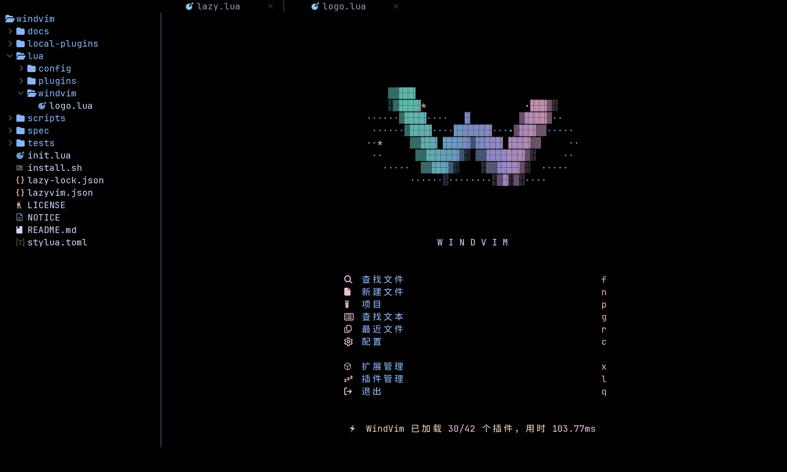
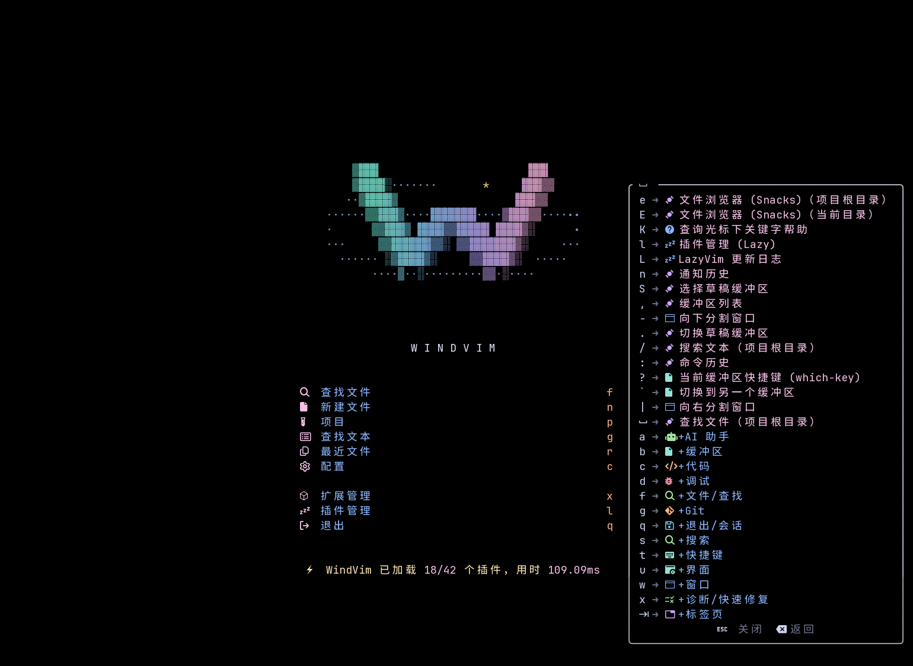
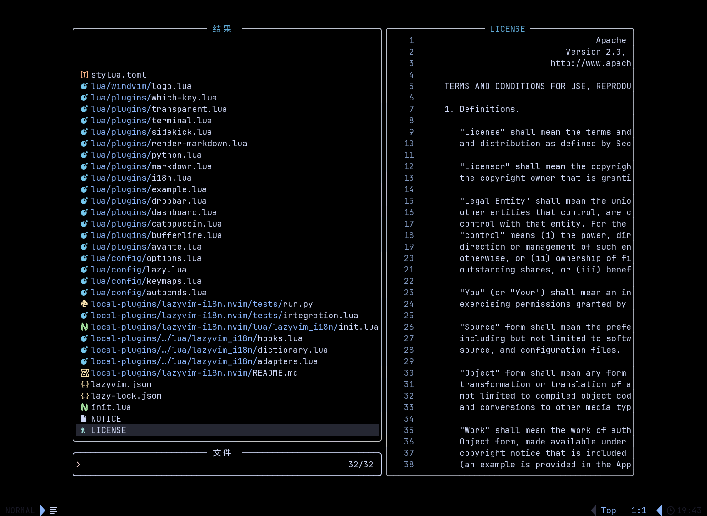

<p align="center">
  
</p>

<h1 align="center">WindVim</h1>

<p align="center">
  <strong>基于 LazyVim 的 Neovim 配置 — 中文界面、AI 侧栏与浮动终端</strong>
</p>

<p align="center">
  <a href="https://www.lazyvim.org/"></a>
  <a href="https://neovim.io/"></a>
  
  <a href="LICENSE"></a>
</p>

WindVim 是基于 [LazyVim](https://github.com/LazyVim/LazyVim) 的个人定制 Neovim 配置，面向习惯终端开发、希望使用中文界面并结合 AI 编程工具的用户。沿用 LazyVim 的插件生态、语言支持与快捷键，再加入一套可以直接使用的界面与工作区配置。

默认以独立应用 `windvim` 运行，可以和已有的 Neovim / LazyVim 并存。支持 Linux、macOS，Windows 可通过 WSL 使用。

## 特性

- **中文 / English 随时切换**：覆盖快捷键菜单、插件管理、常用选择器和启动页，切换后记住选择；文件内容、路径与命令保留原文。
- **AI CLI 侧栏**：通过 Sidekick 接入已安装的 Codex、Claude 等 CLI，支持同一列堆叠多个面板，方便边看代码边协作。
- **浮动终端与导航**：居中圆角终端、文件浏览器、项目搜索、Bufferline 与 Dropbar，沿用熟悉的 LazyVim 操作方式。
- **完整的视觉定制**：Catppuccin 透明主题、Markdown 渲染与专属动态启动页，彩色 W 标识搭配有深度的风环与流动粒子。
- **配置独立、方便修改**：安装时保护已有目录，显式覆盖会先备份；主题、快捷键与本地汉化层都可单独调整。



<table>
  <tr>
    <td><br>中文快捷键菜单</td>
    <td><br>文件搜索与预览</td>
  </tr>
</table>

更多界面见[截图集](docs/GALLERY.md)。

## 安装

> **前置要求**：Neovim ≥ 0.11.2（LuaJIT）、Git、`rsync`。完整依赖见[使用说明](docs/USAGE.md)。

从 GitHub 安装（仓库公开后可用）：

```bash
git clone https://github.com/tingfeng347/windvim.git
cd windvim
./install.sh
~/.local/bin/windvim
```

默认使用独立配置 `~/.config/windvim`，安装器不使用 sudo。首次启动自动下载插件，需要能访问 GitHub；将 `~/.local/bin` 加入 PATH 后可直接运行 `windvim`。已有源码目录时可直接运行 `./install.sh`。

安装选项、源码压缩包下载及各系统依赖见[使用说明](docs/USAGE.md)。Copilot 与 AI CLI 需要各自登录，常规编辑功能可以独立使用。

## 更新

在最初克隆的项目目录运行：

```bash
git pull --ff-only
./install.sh --force
```

更新前会备份旧配置；插件可在编辑器中通过 `:Lazy` 管理。

## 快捷键

Leader 键是空格，其余操作沿用 [LazyVim 默认快捷键](https://www.lazyvim.org/keymaps)。

| 功能 | 快捷键 |
| --- | --- |
| 切换中文 / English | `<Space>uH` |
| 查找文件 / 搜索文本 | `<Space>ff` / `<Space>sg` |
| 文件浏览器 | `<Space>e` |
| 居中浮动终端 | `<Space>tp` |
| 切换 / 选择 AI CLI | `<Space>aa` / `<Space>as` |

## 文档

- [使用说明](docs/USAGE.md)：依赖、安装选项、AI 登录、定制、更新与卸载
- [界面预览](docs/GALLERY.md)：中文菜单、文件选择器、插件管理与英文界面
- [汉化插件](local-plugins/lazyvim-i18n.nvim/README.md)：翻译范围、语言切换与自定义词典
- [开发与分发](docs/DEVELOPMENT.md)：测试、截图复现与源码打包

## 许可

[Apache-2.0](LICENSE)。基于 [LazyVim](https://github.com/LazyVim/LazyVim) 和 [LazyVim Starter](https://github.com/LazyVim/starter)，感谢 [folke](https://github.com/folke) 及各插件作者；来源与修改说明见 [NOTICE](NOTICE)。
