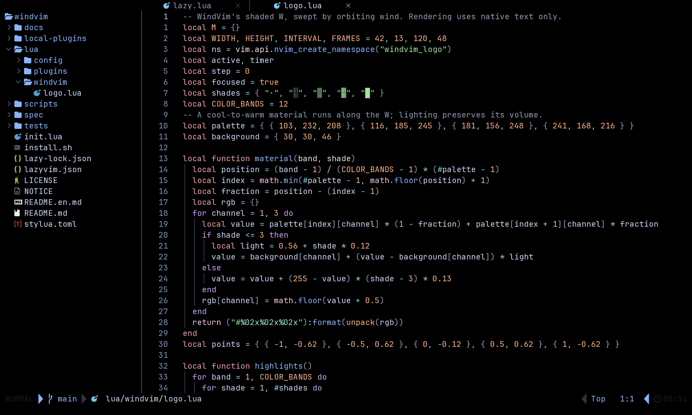
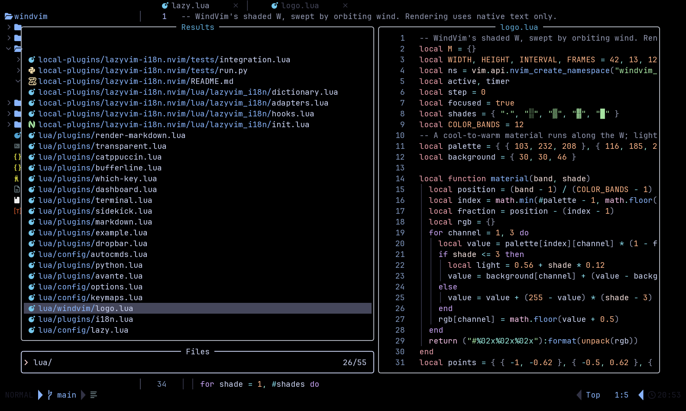

# Gallery

[简体中文](GALLERY.md) · **English** · [Back to README](../README.en.md)

The dashboard stands on its own; editing, key hints and file search use WindVim's source project. All screenshots come from a real Neovim UI with English selected.

## Animated dashboard

## Project editing

Browse the project tree on the left and edit the logo's Lua source on the right.

## Key hints

View file navigation shortcuts beside your code.

## File search and preview

Find Lua files in the project and preview their source.

## Plugin manager

