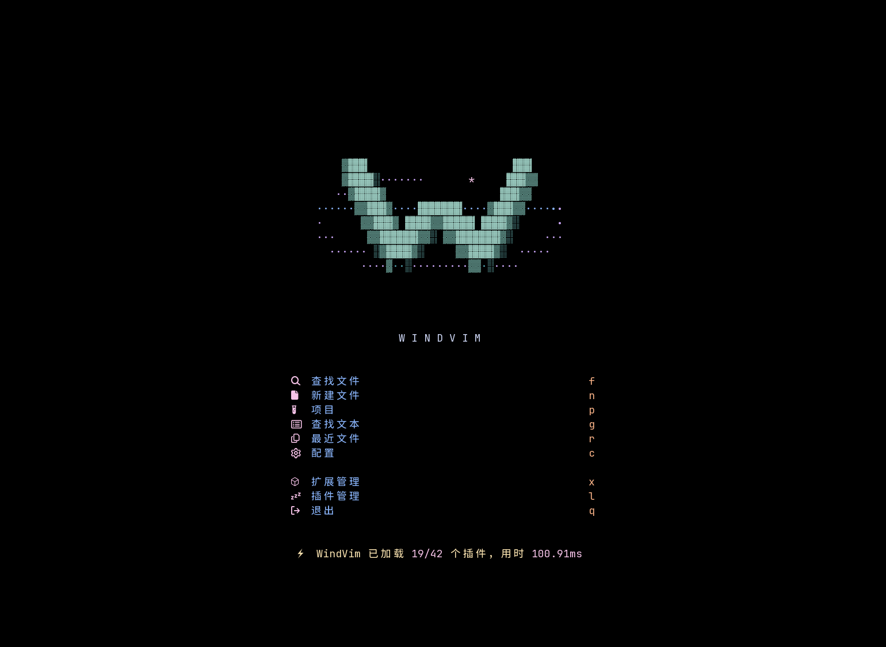
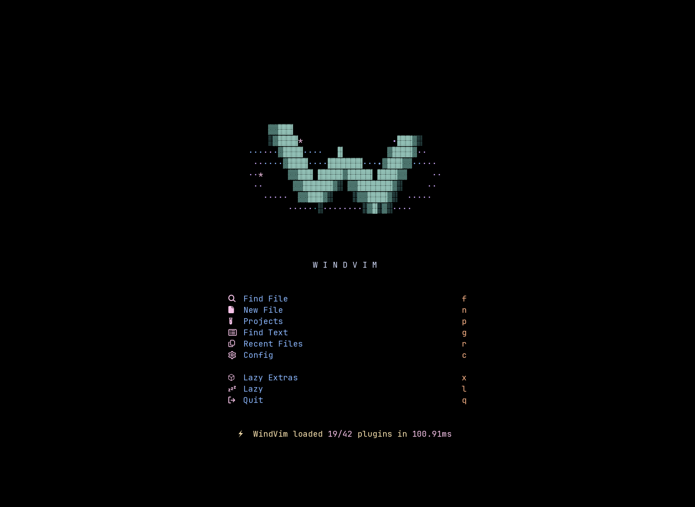

# 界面预览

[返回首页](../README.md)

以下图片由实际 Neovim UI 网格捕获，使用仓库锁定的插件版本；终端背景与字体会影响最终效果。

<table>
  <tr>
    <td> <strong>中文快捷键菜单</strong> · 原有键位与动作保留</td>
    <td> <strong>文件选择器</strong> · 中文标题与路径原文</td>
  </tr>
  <tr>
    <td> <strong>插件管理</strong> · 汉化常用操作与帮助</td>
    <td> <strong>运行时切换英文</strong> · 自动保存语言选择</td>
  </tr>
</table>
